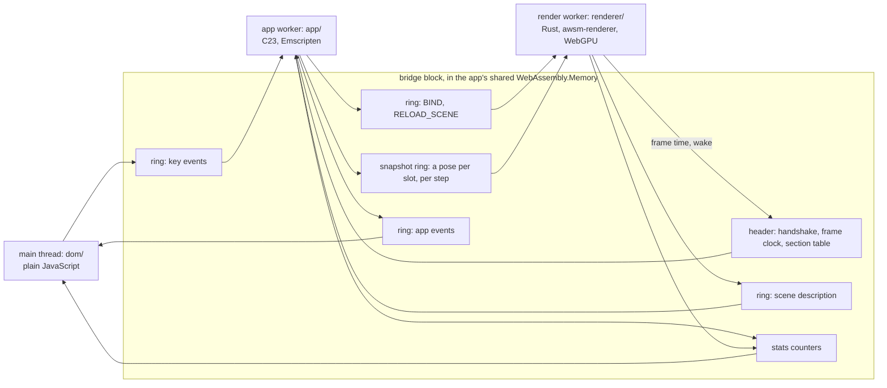
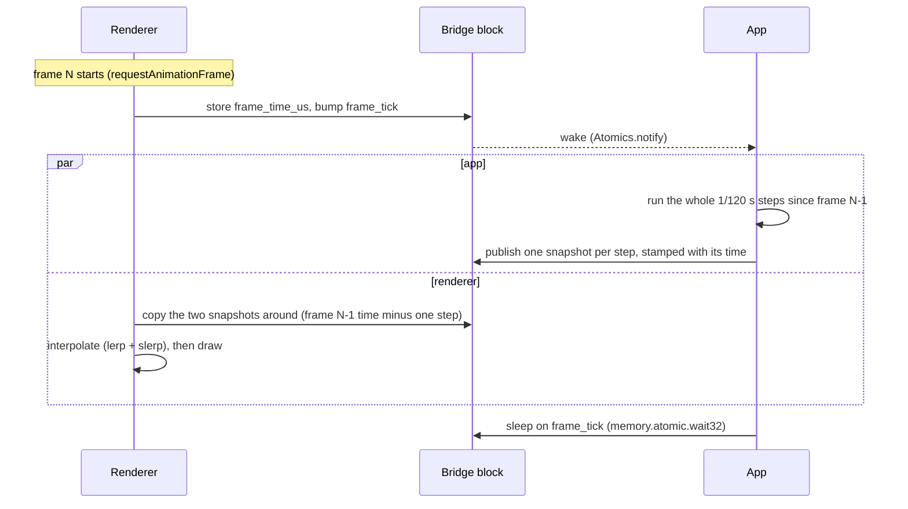
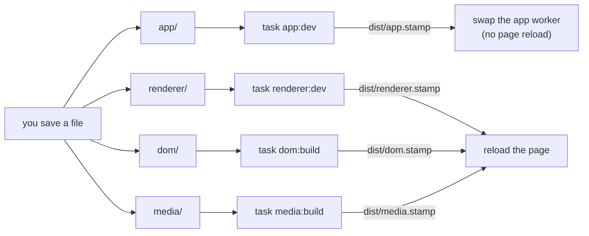

# AWSM Template
## A simple multithreaded app: C logic, a Rust WebGPU renderer, a plain JS page

## **▶ [Live site](https://awsm.fun/experiments/simple-multithreaded-c)**
_the same build also deploys to GitHub Pages on every merge to `main`._

----
A copyable **template** from the [**Awsm**](https://awsm.fun) project: the
smallest useful web app on three threads. A plain JavaScript page owns the
canvas and the keyboard, a Rust renderer draws with WebGPU in a worker, and a
C app in another worker owns all state and logic. They share one block of
memory, the **bridge block**. Saving a C file swaps the new app into the
running page in a second or two, without a page reload and without touching
the Rust build.

```sh
git clone https://github.com/awsm-fun/awsm-template-simple-multithreaded-c
```

For Box3D physics and audio on the same architecture, see the sibling
[physics-multithreaded-c](https://github.com/awsm-fun/awsm-template-physics-multithreaded-c)
template.

| Input | Effect |
| --- | --- |
| W A S D or the arrow keys | roll the ball (it stops at the edges of the ground) |
| Space | put the ball back where it started |
| R | reload the whole scene |

On screen: a red ball on a 12 × 12 m ground, a HUD (top left), **Stats**
(bottom left: frame rate, missed frames, GPU, CPU and app time, frames the app
was late for) and **Settings** (bottom right: render resolution and
anti-aliasing).

The settings start from sensible defaults (`dom/settings.js`). Resolution is
native, held to a pixel budget of 2.8 million pixels but never below one
device pixel per CSS pixel, so a big high-DPI window starts below 100% and a
small one at 100%; touch devices and software GPUs start lower still, and
with anti-aliasing off. A choice you make is remembered in `localStorage` and
always wins; `?reset` in the URL forgets it. The storage keys share one
prefix (`STORAGE_PREFIX`): change it for your own project, since everything
on the same origin shares `localStorage`.

## Quick start

`task setup` checks for every tool except Task itself and prints the install
hint for any that is missing.

| Tool | Install hint (macOS, Homebrew) | Version used |
| --- | --- | --- |
| [Task](https://taskfile.dev) | `brew install go-task` | 3.53 |
| CMake and Ninja | `brew install cmake ninja` | 4.1, 1.13 |
| Emscripten (`emcc`) | `brew install emscripten`, or [emsdk](https://emscripten.org) | 7.0.0 |
| Node | `brew install node` (18 or newer) | 24 |
| watchexec | `brew install watchexec` | 2.3 |
| Rust (`cargo`, via rustup) | [rustup.rs](https://rustup.rs) | 1.100 stable |
| Rust wasm target | `rustup target add wasm32-unknown-unknown` | |
| wasm-bindgen CLI | `cargo install wasm-bindgen-cli --locked --version 0.2.126` | 0.2.126 |
| wasm-opt (Binaryen) | `brew install binaryen` | 123 |
| clang-format (optional, for `task fmt`) | `brew install clang-format` | |

The wasm-bindgen CLI must match the `wasm-bindgen` pin in
`renderer/Cargo.toml` exactly. You also need a browser with WebGPU. No git
submodules, and no separate LLVM: the renderer's `meshopt` dependency needs a
clang that can target wasm, and the tasks use the one bundled with Emscripten
(`em-config LLVM_ROOT`; export `CC_wasm32_unknown_unknown`,
`CXX_wasm32_unknown_unknown` and `AR_wasm32_unknown_unknown` to use another).

```sh
task setup   # check the toolchain, configure the C build (writes the compile database clangd reads)
task dev     # build everything, serve at http://127.0.0.1:8000, open a browser, watch for changes
```

The first build compiles awsm-renderer and its dependencies: several minutes,
once per Rust profile (dev and release are separate). Developed on macOS with
Chrome; CI runs on Ubuntu.

## How it fits together



The layout is defined once, in `app/src/bridge.h`. `postMessage` is only used
at start-up and for rare events such as a Settings change, never per frame.

* **The block lives in the C module's memory** because a wasm module can only
  address its own memory. The app is where you iterate, so it gets plain
  pointers; the page and the renderer use typed-array views.
* **Two wasm modules**, so the app worker can be replaced on its own while the
  renderer keeps running (the hot swap), and the renderer stays a
  single-threaded module on stable Rust. The C side uses `-pthread` only to
  get shared memory and atomics.
* **The app never receives messages.** `app_run()` in `app/src/web_main.c`
  never returns: it sleeps until a frame starts, runs that frame's steps, and
  sleeps again. Everything reaches it through the block.

```
app/                       the C app: a CMake project, Emscripten only
  src/bridge.h, bridge.c   the contract between the three threads (start here)
  src/app.h, app.c         all state and logic (your code goes here)
  src/fixed_step.c         turns frame times into whole 120 Hz steps
  src/web_main.c           browser entry point (app_start, app_run)
  tests/                   test_app.c, test_bridge.c, bridge_layout.c
renderer/                  the Rust crate: cargo + wasm-bindgen (+ wasm-opt)
  src/bridge.rs            the renderer's mirror of bridge.h
  src/render.rs            start-up, the frame loop, attach / detach
  src/scene.rs             loads scene.toml, indexes its named nodes
  src/slots.rs             which scene node each pose slot drives
dom/                       the page: index.html, main.js, style.css
  bridge.js                the page's mirror of bridge.h
  loading.js, stats.js, …  the panels (also settings.js, about.js, modal.js)
media/bundle/scene.toml    the scene: a sun, the ground, a ball and a camera
tools/                     dev-server.mjs, check-bridge.mjs, coi-serviceworker.js
Taskfile.yml, taskfile/    every workflow
```

## One frame, start to finish



This is Glenn Fiedler's ["Fix Your Timestep"](https://gafferongames.com/post/fix_your_timestep/)
split across two threads. The app always steps 1/120 s at a time
(`APP_STEP_HZ` in `app/src/app.h`), as many steps as the time since the last
frame pays for (`app/src/fixed_step.c`, gaps capped at 100 ms), and stamps
each snapshot with its moment on the frame clock. The renderer draws "previous
frame time minus one step" between the two snapshots around it, so motion is
even whether a frame got one step or two. If the app has not published that
far, the renderer holds the newest snapshot and Stats counts an "app late".

## Day-to-day work

Leave `task dev` running. It serves `dist/` with the headers shared memory
needs, and four watchers each rebuild only their own part, so working on C
never runs cargo.



| You edit | What happens |
| --- | --- |
| `app/` | `task app:dev` (`wasm-dev` preset); only the app worker is swapped, 1 to 1.5 s after the save |
| `renderer/` | `task renderer:dev` (crate unoptimized, dependencies optimized, no wasm-opt); reload, 3 to 4 s after the save |
| `dom/`, `media/` | `task dom:build` / `task media:build` (copies); reload |

(Times are from an M1 Max MacBook.) A failed build leaves the page on the
last good build, with the error in the terminal, and the other watchers keep
going. `printf` from C shows in the browser console as `[app] …`.
Variables: `RELOAD=page` (reload instead of swap), `OPEN=` (no browser),
`PORT=9000`.

A hot-swapped app starts from scratch. With `APP_RELOAD_SCENE_ON_HOT_SWAP` at
`1` (the default, in `app/src/app.h`) it also asks the renderer to load the
scene again, so every save starts from `scene.toml` whatever the previous
build did to the world; the loading screen shows for the second that takes.
At `0` it takes over the renderer's current world: instant, and bound nodes
go back to where they were authored. Either way the WebGPU device and the
page stay.

| Task | What it does |
| --- | --- |
| `task setup` | Check the toolchain, configure the C build so clangd works |
| `task dev` | Build, serve at http://127.0.0.1:8000, rebuild what changed on every save |
| `task build` | Release build of everything into a fresh `dist/` (`COI=0` leaves out the header shim) |
| `task serve` | Release build, then serve it (no watching) |
| `task test` | Build and run the app tests under node, including the bridge layout check |
| `task check` | Everything CI runs: clean build and test of both C presets, renderer checks |
| `task fmt` / `task clean` | Format the C and Rust sources / delete all build output |

| Part | Tasks (`task --list` has them all) |
| --- | --- |
| app | `app:dev`, `app:release` (`-O3`), `app:test`, `app:check`, `app:setup`, `app:fmt`, `app:clean` |
| renderer | `renderer:dev`, `renderer:release` (LTO, wasm-opt), `renderer:check` (check, clippy, fmt), `renderer:fmt`, `renderer:clean` |
| other | `dom:build`, `media:build`, `dev:server` (serve `dist/` without building) |

## Where to start editing

Everything happens in `app/src/app.c`. Each step reads the scene description
and the keys, calls `simulate()`, and publishes a snapshot.

* **`simulate(app, dt)`** is your game loop, run every step once the scene is
  ready. Set `position` and `rotation` on `app->objects[...]` (see
  `move_ball()`); driven objects are published for you. Set
  `teleported = true` when an object jumps, so the renderer does not glide
  between the two places.
* **Input.** Poll held keys with `app_key_held(app, BRIDGE_KEY_W)`; one-off
  actions go in `key_event()`, next to Space and R.
* **Talking to the page.** `send_event(app, APP_EVENT_EDGE, where)`, with ids
  from `APP_EVENT_*` in `app.h`. In `dom/main.js`, `APP_EVENT_NAMES` names
  them and the `drain` callback in `frame()` handles them.
* **Starting over.** `app_reload_scene(app)` makes the renderer destroy
  everything and load `scene.toml` again, keeping the GPU device and the page
  (R in the demo). The app then gets the scene described afresh, exactly as
  after the first load; reset your own state in `scene_begin()`.

## Add a new object

A second, smaller sphere, "Buddy", that circles on its own.

**1. The scene.** Append to `media/bundle/scene.toml` a copy of "Ball" with
new ids, name, position and colour. It reuses the unit sphere mesh (`…a1`),
so `scale` is its diameter.

```toml
[[nodes]]
id = "00000000-0000-4000-8000-000000000006"
name = "Buddy"
transform = { translation = [3.0, 0.3, -2.0], rotation = [0.0, 0.0, 0.0, 1.0], scale = [0.6, 0.6, 0.6] }

[nodes.kind.mesh]
mesh = "00000000-0000-4000-8000-0000000000a1"
selected_variant = "00000000-0000-4000-8000-0000000000f6"

[[nodes.kind.mesh.material_variants]]
id = "00000000-0000-4000-8000-0000000000f6"
name = "buddy"

[nodes.kind.mesh.material_variants.instance]
asset = "00000000-0000-4000-8000-0000000000b6"

[nodes.kind.mesh.material_variants.instance.inline]
base_color = [0.10, 0.45, 0.90, 1.0]
metallic = 0.0
roughness = 0.35
emissive = [0.0, 0.0, 0.0]
double_sided = false
vertex_colors_enabled = false
shading = "pbr"
```

**2. An id and a name.** In `app/src/app.h`, add `APP_OBJ_BUDDY,` to
`app_object_id` just before `APP_OBJ_COUNT` (the id is also its pose slot).
In `OBJECTS[]` at the top of `app/src/app.c`, add:

```c
    [APP_OBJ_BUDDY] = {.name = "Buddy", .driven = true},
```

**3. Move it** in `simulate()`, next to `move_ball(app, dt);`:

```c
    app_object *buddy = &app->objects[APP_OBJ_BUDDY];
    if (buddy->found) {
        float angle = (float)app->step * dt * 1.5f; // radians
        vec3 offset = {2.0f * cosf(angle), 0.0f, 2.0f * sinf(angle)};
        buddy->position = vec3_add(buddy->start_position, offset);
    }
```

The media watcher reloads the page and the app watcher hot-swaps the app. No
Rust is rebuilt: the renderer reports every named node and binds what the app
asks for. (The tests describe the scene by hand in `send_scene()` in
`app/tests/test_app.c`. If you add Buddy there, `test_scene_binds_the_ball`
will see a second BIND.)

**Add a key.** Add `BRIDGE_KEY_F = 11` to `app/src/bridge.h` (room up to
`BRIDGE_KEY_COUNT`, 32), `F: 11` to `LAYOUT.key` in `dom/bridge.js`,
`KeyF: KEY.F` to `KEY_CODES` in `dom/main.js`, and `entry("f", BRIDGE_KEY_F);`
to `app/tests/bridge_layout.c` (mirrors may only name what it prints). Then
use it in `key_event()` or with `app_key_held()`.

**Add a record type.** Add it to the record enum in `bridge.h` with its
payload documented, to the `record_type` group in `bridge_layout.c`, and to
the mirror that uses it (`LAYOUT.record_type` in `dom/bridge.js`, or
`renderer/src/bridge.rs`). Push it with `bridge_ring_push()` and handle it
where that ring is read. Consumers skip types they do not know, so the
renderer only needs rebuilding if it must understand the record.

## The bridge in a little more depth

`app/src/bridge.h` documents every field and payload; in short:

* **No locks.** `_Atomic` fields are accessed atomically on all three sides
  (`Atomics.*` in JS). The only blocking wait is the app on `frame_tick`.
* **Snapshots use a seqlock.** `version` is odd while the app writes, even
  when stable; a reader copies, re-checks `version` and retries if it moved.
  The writer never waits. 32 snapshots, 64 pose slots each.
* **Event rings are single-producer, single-consumer.** The producer owns
  `head`, the consumer `tail`; both only count up. A record is 64 bytes (a
  `type`, the app `step`, 14 payload words as `u[i]` or `f[i]`). A full ring
  drops the record and counts it in `dropped`.
* **Names are FNV-1a hashes** (`bridge_hash()`, the same in all three).
* **The mirrors cannot drift.** `app/tests/bridge_layout.c` prints the layout
  as the C compiler sees it and `tools/check-bridge.mjs` compares
  `renderer/src/bridge.rs` and `dom/bridge.js` with it (ctest `bridge_mirrors`).
* **Capacities are free to change** without a renderer rebuild: readers find
  everything through the header's section table.
* **Bump `BRIDGE_VERSION`** (and both mirrors) when an existing field moves or
  changes meaning; the page then reports the mismatch instead of drawing
  garbage. New fields go in `reserved` words.

## Tests

The tests in `app/tests/` are ordinary C programs, compiled to wasm and run
under node by ctest: `task test`. `test_app.c` plays the page and the renderer
with no browser, a worked example for your own. CI runs `task check`.

## Deploying

`task build` writes a complete static site to `dist/`. Shared wasm memory
needs a **cross-origin isolated** page (HTTPS or localhost, with
`Cross-Origin-Opener-Policy: same-origin` and
`Cross-Origin-Embedder-Policy: require-corp`). The dev server sends these. For
hosts that cannot (GitHub Pages, a CDN bucket), `task build` includes
`tools/coi-serviceworker.js`, which adds them in the browser; the first visit
reloads once. `task build COI=0` leaves it out. All URLs are relative, so the
site works from a subpath.

`.github/workflows/deploy.yml` publishes to GitHub Pages on every push to
`main` (set the repository's Pages source to GitHub Actions); `ci.yml` runs
`task check`.

## Using your own scene

Replace `media/bundle/` with an export from the
[awsm scene editor](https://scene.awsm.fun) (its `scene.toml` and `assets/`).
The app expects, by name (`OBJECTS[]` in `app/src/app.c`):

* **"Ball"**, the node it moves, and **"Ground"**, an axis-aligned rectangle
  around that node that the ball stays on. A missing name is logged.
* **A camera**: the node `active_camera` names. To move it, bind it like any
  other object.
* **Unit-sized meshes**: a sphere of diameter 1 and a 1 × 1 plane, so `scale`
  is size in metres (`UNIT_SPHERE_RADIUS`, `UNIT_PLANE_HALF`, used by
  `simulate()` and `keep_on_ground()`). See the header comment of `scene.toml`.

## Limitations

* **Tested on macOS with Chrome** (CI on Ubuntu); other browsers are untried.
* **App state does not survive a hot swap.**
* **Fixed app memory**: 32 MB, `-sINITIAL_MEMORY` in `app/CMakeLists.txt`.
  It cannot grow, because the other threads hold views of it.
* **Bind only**: the app moves nodes that are in the scene but cannot spawn
  new ones. The [physics template](https://github.com/awsm-fun/awsm-template-physics-multithreaded-c)
  shows how.

## Licences and credits

Licensed under either the MIT licence (`LICENSE-MIT`) or the Apache Licence
2.0 (`LICENSE-APACHE`), at your option. Third-party pieces in the repository:

| Path | What | Licence |
| --- | --- | --- |
| `renderer/vendored/basis/` | [Basis Universal](https://github.com/BinomialLLC/basis_universal) transcoder | Apache-2.0 |
| `renderer/vendored/workers/basis-worker.js` | the Basis worker from [awsm-renderer](https://github.com/awsm-fun/awsm-renderer) | MIT OR Apache-2.0 |
| `tools/coi-serviceworker.js` | coi-serviceworker v0.1.7 | MIT |

The Basis transcoder is only fetched for scenes with KTX2 textures: the demo
has none, scenes exported from the awsm scene editor usually do. The renderer
is built on [awsm-renderer](https://github.com/awsm-fun/awsm-renderer) (MIT OR
Apache-2.0), fetched by cargo.
